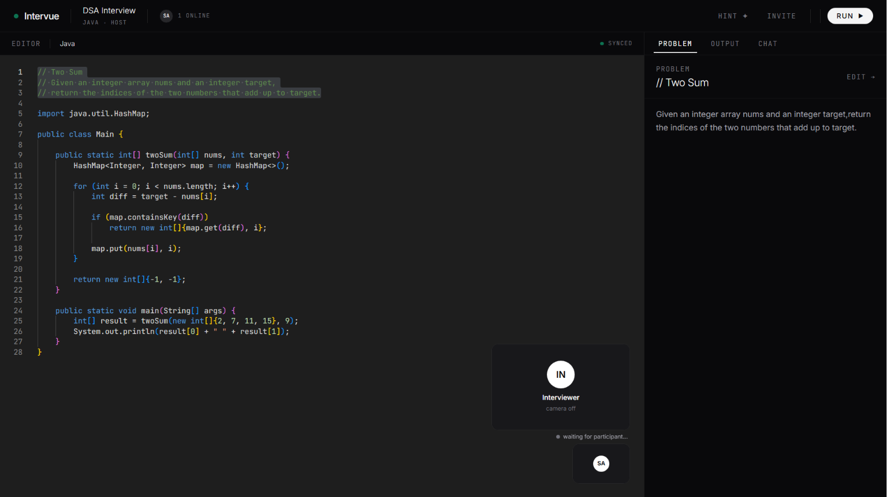
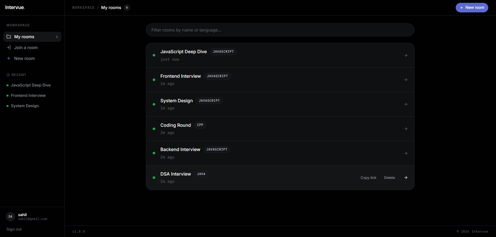
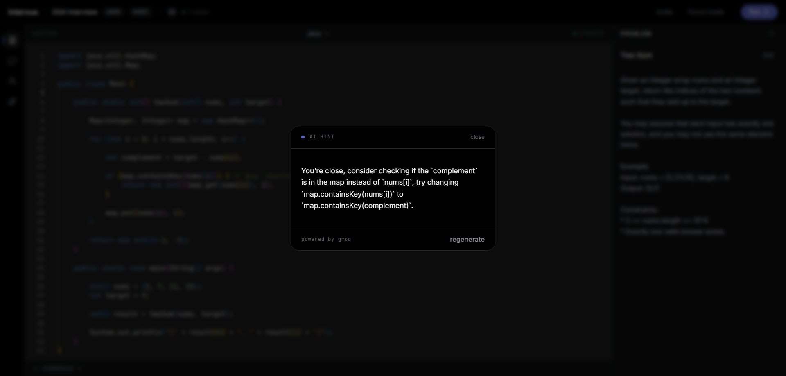
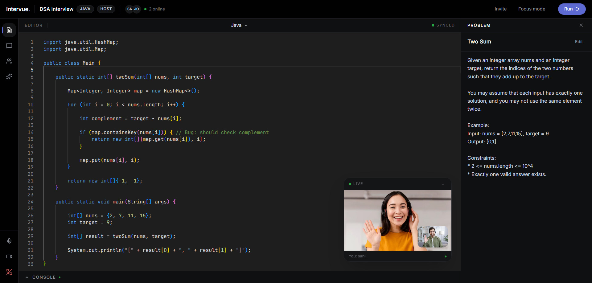

<p align="center">
  
</p>

<h1 align="center">Intervue.</h1>

<p align="center">
Real-time collaborative coding interviews with live video and AI hints.
</p>

<p align="center">
  <a href="https://intervue-eti.pages.dev">
    
  </a>
</p>

<p align="center">


</p>

---

<p align="center">

</p>

---

## What is Intervue?

A coding interview platform that puts the entire interview in one workspace — shared editor, video call, AI hints, and chat, all scoped to a shareable room link.

Built for interviewers who want CoderPad-level collaboration without the price tag.

> **Note:** Intervue is currently optimized for **desktop browsers only**. Mobile/responsive support is not yet implemented — for the best experience, use a laptop or desktop screen.

---

## Features

- **Collaborative editor** — Monaco + Yjs CRDT. Multiple users edit simultaneously with live cursors showing who is where.
- **WebRTC video calling** — Peer-to-peer video and audio directly between browsers. Picture-in-picture overlay with mic and camera controls.
- **AI hints** — Groq Llama 3.3 70B analyzes the candidate's actual code and gives contextual nudges without revealing the solution.
- **Sandboxed execution** — Run code in 6 languages (JavaScript, Python, C++, C, Java, TypeScript) via JDoodle.
- **Problem statement panel** — Host writes the question live. All participants see updates instantly.
- **Room-scoped chat** — Real-time chat with unread indicators, persisted across tab switches.
- **Live presence** — Avatars in the top bar update in real time as users join and leave.

---

## Tech Stack

**Frontend** — React 19, Vite 5, Monaco Editor, Yjs, y-websocket, Socket.io Client, Zustand, TailwindCSS, Lucide React, Sonner

**Backend** — Node.js, Express, PostgreSQL (Neon), Socket.io, JWT, bcryptjs, Helmet, express-rate-limit

**External** — Groq API (Llama 3.3 70B), JDoodle (code execution), Google STUN (WebRTC)

**Hosting** — Cloudflare Pages (frontend), Render (backend + y-websocket), Neon (database), UptimeRobot (keep-alive)

---

## Architecture

```
Browser A                                            Browser B
    │                                                    │
    │  REST + Socket.io                                  │
    ├──────────────► Express + Socket.io ◄───────────────┤
    │                      │                             │
    │                      ├─► PostgreSQL (Neon)         │
    │                      ├─► Groq API (hints)          │
    │                      └─► JDoodle (execution)       │
    │                                                    │
    │  y-websocket (editor sync)                         │
    ├──────────────► Yjs WebSocket Server ◄──────────────┤
    │                                                    │
    │  WebRTC (video — direct P2P after handshake)       │
    └────────────────────────────────────────────────────┘
```

Three real-time channels in parallel:

- **Socket.io** — presence, chat, problem sync, WebRTC signaling
- **y-websocket** — collaborative editor (CRDT)
- **WebRTC** — peer-to-peer video and audio (no server after handshake)

---

## Project Structure

```
intervue/
├── Backend/
│   └── src/
│       ├── configs/
│       ├── controllers/
│       │   ├── auth.controllers.js
│       │   ├── room.controllers.js
│       │   ├── execute.controllers.js
│       │   └── hint.controllers.js
│       ├── middlewares/
│       ├── routes/
│       ├── sockets/
│       │   └── socketHandler.js
│       ├── database/
│       │   └── schema.sql
│       └── server.js
│
├── Frontend/
│   └── src/
│       ├── api/
│       ├── components/
│       ├── hooks/
│       │   └── useWebRTC.js
│       ├── lib/
│       ├── pages/
│       ├── store/
│       └── App.jsx
│
├── YWebSocket/
│   └── server.js
│
└── README.md
```

---

## Deployment

| Service     | Provider         | Purpose                    |
| ----------- | ---------------- | -------------------------- |
| Frontend    | Cloudflare Pages | Static build, CDN          |
| Backend     | Render           | Express + Socket.io        |
| Y-WebSocket | Render           | Yjs sync server            |
| Database    | Neon             | PostgreSQL serverless      |
| Uptime      | UptimeRobot      | Prevent Render cold starts |

Frontend and both Render services auto-deploy on push to `main`. UptimeRobot pings every 5 minutes to keep them warm.

---

## API Reference

### Auth

| Method | Endpoint           | Description    |
| ------ | ------------------ | -------------- |
| POST   | /api/auth/register | Create account |
| POST   | /api/auth/login    | Login          |
| GET    | /api/auth/me       | Current user   |

### Rooms

| Method | Endpoint                      | Description                |
| ------ | ----------------------------- | -------------------------- |
| POST   | /api/rooms                    | Create room                |
| POST   | /api/rooms/join/:shareLink    | Join by share link         |
| GET    | /api/rooms/my                 | User's rooms               |
| GET    | /api/rooms/:shareLink         | Room details               |
| PATCH  | /api/rooms/:shareLink/problem | Update problem (host only) |
| DELETE | /api/rooms/:id                | Delete room                |

### Execution & AI

| Method | Endpoint     | Description |
| ------ | ------------ | ----------- |
| POST   | /api/execute | Run code    |
| POST   | /api/hint    | Get AI hint |

---

## Socket Events

| Event                | Direction       | Purpose                |
| -------------------- | --------------- | ---------------------- |
| join-room            | Client → Server | Enter room             |
| leave-room           | Client → Server | Exit room              |
| user-joined          | Server → Client | New user notification  |
| user-left            | Server → Client | User left notification |
| room-users           | Server → Client | Active users list      |
| problem-updated      | Bidirectional   | Problem statement sync |
| chat:send            | Client → Server | Send message           |
| chat:received        | Server → Client | Broadcast message      |
| webrtc:offer         | Bidirectional   | SDP offer              |
| webrtc:answer        | Bidirectional   | SDP answer             |
| webrtc:ice-candidate | Bidirectional   | ICE exchange           |
| webrtc:leave         | Bidirectional   | Call ended             |

---

## Security

- Helmet for HTTP security headers
- CORS whitelist — only accepted origins
- JWT on all protected routes
- bcrypt password hashing
- Rate limiting — login (5/15min), register (3/hour), hints (20/hour)
- Body size limit (100kb) against DoS
- SQL ownership checks so users cannot touch others' resources

---

## Installation

```bash
git clone https://github.com/sahil78tt/intervue.git
cd intervue
```

```bash
cd Backend && npm install
cd ../Frontend && npm install
cd ../YWebSocket && npm install
```

Run three terminals:

```bash
# Terminal 1
cd Backend && npm run dev

# Terminal 2
cd YWebSocket && npm start

# Terminal 3
cd Frontend && npm run dev
```

Open `http://localhost:5173` in two separate browsers to test collaboration.

---

## Environment Variables

**Backend** — `Backend/.env`

```
PORT=8003
DATABASE_URL=
JWT_SECRET=
JWT_EXPIRES_IN=7d
JDOODLE_CLIENT_ID=
JDOODLE_CLIENT_SECRET=
GROQ_API_KEY=
GROQ_MODEL=llama-3.3-70b-versatile
FRONTEND_URL=http://localhost:5173
```

**Frontend** — `Frontend/.env`

```
VITE_API_URL=http://localhost:8003/api
VITE_SOCKET_URL=http://localhost:8003
VITE_WS_URL=ws://localhost:1234
```

---

## Screenshots

<p align="center">

</p>

<p align="center">

</p>

<p align="center">

</p>

---

## Known Limitations

- **Desktop only** — the UI is currently designed and tested for desktop browsers. Mobile and tablet layouts are not yet supported.
- **WebRTC across strict NATs** — video/audio uses STUN only, which works reliably on the same network or "friendly" NATs. For production use across arbitrary networks (strict NATs/firewalls), a TURN server (e.g. Metered.ca or Twilio) would be required.

---

<p align="center">
Built by <a href="https://github.com/sahil78tt">Sahil Vishwakarma</a> · MIT License
</p>
