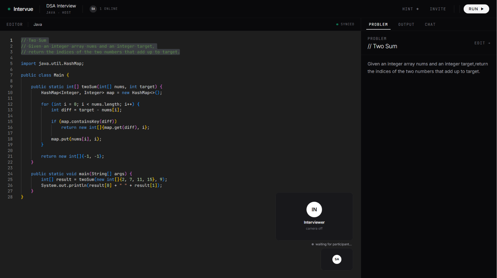

# Intervue.

<p align="center">
  
</p>

<h1 align="center">Intervue.</h1>

<p align="center">
  Real-time collaborative coding interviews with live video and AI hints.
</p>

<p align="center">
  <a href="https://intervue-eti.pages.dev">
    
  </a>
</p>

<p align="center">
  
  
  
  
  
  
  
  
</p>

---

<p align="center">
  
</p>

---

## What is Intervue?

Intervue is a real-time collaborative coding interview platform that brings everything into one workspace: a shared code editor, video calling, AI-powered hints, and room-based chat.

Create a room, share its link, and start collaborating instantly.

Built for interviewers who want CoderPad-level collaboration without the price tag.

> **Note:** Intervue is currently optimized for desktop browsers. Mobile and tablet support is not yet implemented. For the best experience, use a laptop or desktop.

---

## Features

- **Collaborative Code Editor** — Monaco Editor with Yjs CRDT enables multiple participants to edit code simultaneously, with live cursors showing each participant's position.
- **WebRTC Video Calling** — Peer-to-peer video and audio directly between browsers, with picture-in-picture support and microphone and camera controls.
- **AI-Powered Hints** — Groq Llama 3.3 70B analyzes the candidate's actual code and provides contextual hints without revealing the complete solution.
- **Integrated Code Execution** — Execute code in six languages: JavaScript, Python, C++, C, Java, and TypeScript using the JDoodle API.
- **Live Problem Statements** — The host can write and update problem statements, which are synchronized instantly across all participants.
- **Room-Scoped Chat** — Real-time messaging with unread indicators and persistent chat state across tab switches.
- **Authenticated Real-Time Communication** — Socket.io connections are authenticated using the same JWT as the REST API. Unauthorized connections are rejected during the handshake.
- **Live User Presence** — Participant avatars update instantly as users join or leave a room.

---

## Tech Stack

### Frontend

- React 19
- Vite 5
- Monaco Editor
- Yjs and y-websocket
- Socket.io Client
- Zustand
- Tailwind CSS
- Lucide React
- Sonner

### Backend

- Node.js
- Express 5
- PostgreSQL (Neon)
- Socket.io
- JWT Authentication
- bcryptjs
- Helmet
- express-rate-limit

### Testing

- Vitest
- Supertest
- socket.io-client

### External Services

- Groq API — Llama 3.3 70B for AI hints
- JDoodle API — Code execution
- Google STUN — WebRTC connectivity

### Hosting

- Cloudflare Pages — Frontend
- Render — Backend and Yjs WebSocket server
- Neon — PostgreSQL database
- UptimeRobot — Backend keep-alive

---

## Architecture

```text
                    ┌─────────────────────┐
                    │      Browser A      │
                    └──────────┬──────────┘
                               │
             ┌─────────────────┼──────────────────┐
             │                 │                  │
        REST + Socket.io   y-websocket          WebRTC
             │                 │                  │
             ▼                 ▼                  │
    ┌────────────────┐  ┌───────────────┐         │
    │ Express Server │  │ Yjs WebSocket │         │
    │ + Socket.io    │  │    Server     │         │
    └───────┬────────┘  └───────────────┘         │
            │                                      │
       ┌────┼─────────────┐                        │
       │    │             │                        │
       ▼    ▼             ▼                        │
    Neon   Groq        JDoodle                     │
       │    │             │                        │
       └────┴─────────────┘                        │
                                                  │
                    ┌─────────────────────┐       │
                    │      Browser B      │◄──────┘
                    └─────────────────────┘
```

Three real-time communication channels work in parallel:

1. **Socket.io** — Handles user presence, chat, problem statement synchronization, and WebRTC signaling. Connections are JWT authenticated.
2. **y-websocket** — Handles collaborative editor synchronization using Yjs CRDT.
3. **WebRTC** — Handles peer-to-peer video and audio communication directly between browsers after signaling.

---

## Project Structure

```text
intervue/
│
├── Backend/
│   ├── src/
│   │   ├── configs/
│   │   ├── controllers/
│   │   ├── middlewares/
│   │   ├── routes/
│   │   ├── sockets/
│   │   ├── database/
│   │   └── server.js
│   │
│   ├── tests/
│   ├── package.json
│   └── vitest.config.js
│
├── Frontend/
│   ├── public/
│   │   ├── favicon.svg
│   │   └── screenshots/
│   │
│   ├── src/
│   │   ├── api/
│   │   ├── components/
│   │   ├── hooks/
│   │   ├── lib/
│   │   ├── pages/
│   │   ├── store/
│   │   └── App.jsx
│   │
│   └── package.json
│
├── YWebSocket/
│   ├── server.js
│   ├── utils.js
│   └── package.json
│
└── README.md
```

---

## Installation and Setup

### Prerequisites

- Node.js 18 or later
- npm
- PostgreSQL database (Neon recommended)
- Groq API key
- JDoodle API credentials

### 1. Clone the Repository

```bash
git clone https://github.com/sahil78tt/intervue.git

cd intervue
```

### 2. Install Dependencies

```bash
cd Backend
npm install

cd ../Frontend
npm install

cd ../YWebSocket
npm install
```

### 3. Configure Environment Variables

Create the following environment files.

**Backend — `Backend/.env`**

```env
PORT=8003

DATABASE_URL=

JWT_SECRET=
JWT_EXPIRES_IN=7d

JDOODLE_CLIENT_ID=
JDOODLE_CLIENT_SECRET=

GROQ_API_KEY=
GROQ_MODEL=llama-3.3-70b-versatile

FRONTEND_URL=http://localhost:5173
```

**Frontend — `Frontend/.env`**

```env
VITE_API_URL=http://localhost:8003/api
VITE_SOCKET_URL=http://localhost:8003
VITE_WS_URL=ws://localhost:1234
```

### 4. Start the Application

Run each service in a separate terminal.

**Terminal 1 — Backend**

```bash
cd Backend
npm run dev
```

**Terminal 2 — Yjs WebSocket Server**

```bash
cd YWebSocket
npm start
```

**Terminal 3 — Frontend**

```bash
cd Frontend
npm run dev
```

### 5. Open the Application

Visit:

```text
http://localhost:5173
```

Open the application in two separate browser sessions to test real-time collaboration.

---

## Testing

The backend includes an integration test suite built with **Vitest** and **Supertest**.

### Run Tests

```bash
cd Backend

npm install

npm test
```

<details>
<summary><strong>Test Coverage</strong></summary>

**Current Test Results: 80 Tests Passing**

The test suite covers:

- **Authentication and Rooms** — Registration, login, JWT validation, room creation, joining, and ownership checks, including 403 and 404 responses.
- **Code Execution and AI Hints** — Execution proxying with mocked JDoodle responses and AI hint generation with mocked Groq responses.
- **Rate Limiting** — Verifies the five-requests-per-hour limit for AI hints per user.
- **WebSockets** — Tests real Socket.io server connections, JWT handshake authentication, authorization failures, and cross-room data isolation.

**Testing Notes:**

Tests use `tests/helpers/app.js` to mount routes on a fresh Express application. External services such as PostgreSQL, Axios, and fetch are mocked, so no real database connection or external API keys are required to run the test suite.

</details>

---

## API Reference

### Authentication

| Method | Endpoint             | Description       |
| :----- | :------------------- | :---------------- |
| POST   | `/api/auth/register` | Create an account |
| POST   | `/api/auth/login`    | Log in            |
| GET    | `/api/auth/me`       | Get current user  |

### Rooms

| Method | Endpoint                        | Description                          |
| :----- | :------------------------------ | :----------------------------------- |
| POST   | `/api/rooms`                    | Create a room                        |
| POST   | `/api/rooms/join/:shareLink`    | Join using a share link              |
| GET    | `/api/rooms/my`                 | Get user's rooms                     |
| GET    | `/api/rooms/:shareLink`         | Get room details                     |
| PATCH  | `/api/rooms/:shareLink/problem` | Update problem statement (host only) |
| DELETE | `/api/rooms/:id`                | Delete a room                        |

### Code Execution and AI

| Method | Endpoint       | Description       |
| :----- | :------------- | :---------------- |
| POST   | `/api/execute` | Execute code      |
| POST   | `/api/hint`    | Generate AI hints |

---

## Socket.io Events

The Socket.io server requires a valid JWT passed through `auth: { token }` during the connection handshake.

| Event                  | Direction       | Purpose                                   |
| :--------------------- | :-------------- | :---------------------------------------- |
| `join-room`            | Client → Server | Join a room                               |
| `leave-room`           | Client → Server | Leave a room                              |
| `user-joined`          | Server → Client | Notify when a user joins                  |
| `user-left`            | Server → Client | Notify when a user leaves                 |
| `room-users`           | Server → Client | Get active room participants              |
| `problem-updated`      | Bidirectional   | Synchronize problem statements            |
| `chat:send`            | Client → Server | Send a chat message                       |
| `chat:received`        | Server → Client | Broadcast a chat message                  |
| `webrtc:offer`         | Bidirectional   | Exchange SDP offers                       |
| `webrtc:answer`        | Bidirectional   | Exchange SDP answers                      |
| `webrtc:ice-candidate` | Bidirectional   | Exchange ICE candidates                   |
| `webrtc:leave`         | Bidirectional   | Notify when a participant leaves the call |

---

## Security

Intervue implements several security measures:

- **Helmet** — Adds HTTP security headers.
- **CORS Whitelist** — Restricts requests to accepted origins.
- **JWT Authentication** — Protects authenticated REST API routes.
- **Socket.io Authentication** — Validates JWTs during WebSocket handshakes and rejects unauthorized connections before event handlers run.
- **Password Hashing** — Uses bcryptjs to securely hash passwords.
- **Rate Limiting** — Limits AI hint requests to five per hour per user.
- **Request Body Limit** — Restricts request payloads to 100 KB to reduce DoS exposure.
- **SQL Ownership Checks** — Prevents users from accessing or modifying resources belonging to other users.

---

## Known Limitations

- **Desktop Only:** The interface is currently designed and tested for desktop browsers. Mobile and tablet layouts are not yet supported.
- **WebRTC Across Strict NATs:** Video and audio currently use STUN only. Connections work reliably on the same network and compatible NAT configurations. A TURN server (such as Metered.ca or Twilio) would be required for more reliable connectivity across restrictive networks and firewalls.
- **Yjs WebSocket Authentication:** The Yjs WebSocket server currently does not verify JWTs, unlike the Socket.io server. Adding token verification during the WebSocket upgrade is a planned security improvement.
- **Socket Room Authorization:** The Socket.io middleware verifies user authentication but does not currently query the database to confirm active membership of the specific room associated with every socket event.

---

## Future Improvements

- Mobile and tablet responsive layouts.
- JWT authentication for the Yjs WebSocket server.
- Database-backed Socket.io room membership validation.
- TURN server integration for more reliable WebRTC connectivity.
- Additional programming language support.

---

## License

This project is licensed under the MIT License.

---

<p align="center">
  Built by <a href="https://github.com/sahil78tt">Sahil Vishwakarma</a>
</p>

<p align="center">
  <a href="https://github.com/sahil78tt/intervue">GitHub Repository</a>
  ·
  <a href="https://intervue-eti.pages.dev">Live Demo</a>
</p>
